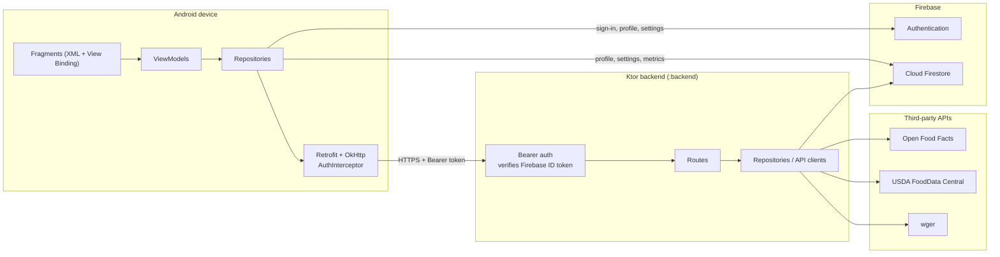
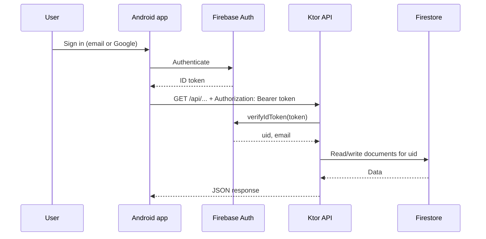

# Kenkosa Health Application

**An Android app for tracking nutrition, fitness, sleep, fasting, medication and mood in one place, backed by a Kotlin/Ktor REST API and Firebase.**

PROG7314 · BCAD3 Group 2

Group Members: 
Qaniah Arnold (ST10448055), Jade Heeger (ST10445517), Brandon Less (ST10441540) 


## 1. Purpose and scope

### Purpose

Most people who want to look after their health end up juggling several apps: one for food, one for workouts, one for sleep, another for medication reminders. **Kenkosa Health** brings these together into a single mobile app so a user can see their day at a glance, log entries quickly, and track progress against personal goals.

### Application Overview

- Secure account creation and sign-in (email/password and Google single sign-on)
- A home dashboard linking to every health module
- Food logging with barcode scanning and food search, plus a meal history
- Water intake, fasting, sleep, medication, mood and goal tracking
- A workout browser and a "Know Your Health" article library
- Body metrics and user settings (theme, language, notifications, personal targets)
- A REST API that keeps user data behind authentication

---

## 2. Features

| Module | What it does |
|---|---|
| **Authentication** | Email/password sign-up and login, Google SSO, and sign-out via Firebase Authentication |
| **Home dashboard** | Entry point to every module, with navigation to Settings and Statistics |
| **Food diary** | Log meals by type, scan a barcode with the camera, search foods by name, and browse meal history |
| **Water intake** | Log water through the day and see progress |
| **Fasting** | Record fasts and view progress on a ring display, with a history of past fasts |
| **Sleep** | Log sleep and view a ring and weekly bar chart against a sleep target |
| **Medication** | Add medications with schedules and mark doses as taken |
| **Wellness** | Log your mood and browse guided meditation videos |
| **Goals** | Create daily, weekly or monthly goals (steps, water, sleep, exercise or custom) and update progress |
| **Fitness** | Browse workout categories and exercises from the wger exercise database |
| **Know Your Health** | Read health and lifestyle articles |
| **Metrics** | Record and update personal body metrics |
| **Settings** | Appearance (light/dark), language, notification preference, profile, and personal targets (daily steps, calories, sleep) |

---

## 3. Screenshots

| Login | Home | Food diary |
|:---:|:---:|:---:|
|  |  |  |

| Barcode scanner | Sleep | Fasting |
|:---:|:---:|:---:|
|  |  |  |

| Goals | Wellness | Settings |
|:---:|:---:|:---:|
|  |  |  |

---

## 4. Architecture and design considerations

### 4.1 System overview

Kenkosa Health is a **client/server system** made of two Gradle modules in one repository: an Android client (`:app`) and a Ktor REST API (`:backend`). Firebase provides identity and storage for both.



### 4.2 Android app: MVVM with a repository layer

| Layer | Responsibility | Package |
|---|---|---|
| **UI** | Fragments, adapters and custom views (rings, bar charts). Only renders state and forwards user actions | `ui/<feature>/` |
| **ViewModel** | Holds screen state, survives configuration changes, exposes results to the UI | `ui/<feature>/*ViewModel.kt` |
| **Repository** | Single source of truth per feature; hides whether data comes from the API or Firebase; wraps results in an `ApiResult` type for consistent error handling | `data/repository/` |
| **Network / models** | Retrofit interfaces, DTOs, and one shared `RetrofitInstance` | `data/network/`, `data/model/` |

### 4.3 Backend: Ktor with a plugin-per-concern layout

The API is a small Ktor server on Netty. Cross-cutting concerns are installed as plugins in `Application.module()` in a fixed order: **Firebase → Serialization → Authentication → StatusPages → Routing**. Each health feature has its own `routes/`, `models/` and `repository/` file, so a feature can be added or changed without touching the others.

### 4.4 Authentication flow

The client never sends passwords to our API. It signs in with Firebase, then attaches the Firebase ID token to every API request. The server verifies the token with the Firebase Admin SDK and scopes all data to the token's `uid`.



### 4.5 Project structure

```
kenkosaHealthApp_PROG7314/
├── app/                                  # Android client
│   └── src/main/
│       ├── java/.../kenkosahealthapp_prog7314/
│       │   ├── MainActivity.kt
│       │   ├── data/
│       │   │   ├── model/                # User, UserSettings, UserMetrics
│       │   │   ├── network/              # Retrofit APIs, DTOs, AuthInterceptor
│       │   │   └── repository/           # One repository per feature
│       │   └── ui/                       # auth, home, diary, fasting, fitness,
│       │                                 # goals, knowhealth, medication, metrics,
│       │                                 # settings, sleeplog, water, wellness
│       └── res/                          # layouts, nav_graph, values, values-af, values-xh
├── backend/                              # Ktor REST API
│   └── src/main/
│       ├── java/com/kenkosa/backend/
│       │   ├── Application.kt
│       │   ├── plugins/                  # Firebase, Authentication, Routing, ...
│       │   ├── routes/                   # One file per feature
│       │   ├── models/
│       │   └── repository/               # Firestore + third-party API clients
│       └── resources/application.conf
├── gradle/libs.versions.toml
└── settings.gradle.kts
```

---

## 5. Tech stack

| Area | Technology |
|---|---|
| Language | Kotlin |
| Android UI | XML layouts, View Binding, Material Components, Navigation Component, RecyclerView |
| Android architecture | MVVM, ViewModel, Kotlin coroutines |
| Networking | Retrofit, OkHttp, Gson, Coil (images) |
| Camera and scanning | CameraX, ML Kit Barcode Scanning |
| Identity and data | Firebase Authentication, Google Sign-In, Cloud Firestore |
| Backend | Ktor 2.3 (Netty), kotlinx.serialization, Firebase Admin SDK |
| External data | Open Food Facts, USDA FoodData Central, wger |
| Build | Gradle (Kotlin DSL) with a version catalog |
| Target | Android `minSdk 35`, `targetSdk 36` |

---

## 6. Getting started

### Prerequisites

- Android Studio (recent stable release) with an Android emulator or device running **API 35 or higher**
- A JDK supported by Gradle 9.x (Android Studio's bundled JDK works)
- A Firebase project with **Authentication** (Email/Password and Google) and **Cloud Firestore** enabled
- A free [USDA FoodData Central API key](https://fdc.nal.usda.gov/api-key-signup.html) (for food search)

### 1. Clone the repository

```bash
git clone https://github.com/st10448055/KenkosaHealthApp-repository-prog7314.git
cd KenkosaHealthApp-repository-prog7314
```

### 2. Configure Firebase

**Android app:** download `google-services.json` from your Firebase project settings and place it at `app/google-services.json`.

**Backend:** in Firebase console go to *Project settings → Service accounts → Generate new private key*, and save the file as `backend/serviceAccountKey.json`.

> **Never commit `serviceAccountKey.json`.** It is listed in `.gitignore`. If you need to point to a different location, set `FIREBASE_SERVICE_ACCOUNT_PATH`.

### 3. Run the backend

| Variable | Purpose | Default |
|---|---|---|
| `USDA_API_KEY` | USDA FoodData Central key used for food search | none (food search will not return results) |
| `FIREBASE_SERVICE_ACCOUNT_PATH` | Path to the service account JSON | `serviceAccountKey.json` |
| `PORT` | Port the server listens on | `8080` |

```bash
# macOS / Linux
export USDA_API_KEY=your_key_here
./gradlew :backend:run

# Windows (PowerShell)
$env:USDA_API_KEY="your_key_here"
.\gradlew.bat :backend:run
```

The API is now available at `http://localhost:8080`.

### 4. Run the app

1. Open the project in Android Studio and let Gradle sync.
2. Select the `app` run configuration and an emulator or device.
3. Press **Run**.

The API base URL is set in `RetrofitInstance.kt` and defaults to `http://10.0.2.2:8080/`, which is the Android emulator's alias for the host machine's `localhost`. When running on a physical device or against a hosted backend, change `BASE_URL` to the correct address.

### Build a debug APK

```bash
./gradlew :app:assembleDebug
```

---

## 7. Version control

The project is managed in Git and hosted on GitHub. Three team members contributed, and all work was done on branches rather than directly on `main`.

### 7.1 Branching strategy

```mermaid
flowchart LR
    main["main"] --> part2["part2<br/>auth, navigation, settings"]
    part2 --> dev["feature/dev<br/>home, side nav, goals, sleep"]
    dev --> settings["updated-settings<br/>languages, food search UI"]
    settings --> med["feature/medication"]
    med --> well["feature/wellness"]
    well --> food["feature/food-search<br/>barcode scanner"]
    food --> fast["feature/fasting"]
    fast --> work["feature/workouts"]
    work --> water["feature/water-intake"]
    water --> metrics["feature/user-metrics"]
    metrics --> diary["feature/diary"]
```

`main` is the default branch and holds the stable baseline. Work is done on short, purpose-named branches: a `feature/<name>` branch for each feature area. Branches were created from the latest completed branch, so each new feature builds on the work before it and the feature branches form a stack that leads back into `main`.



| Branch | Focus |
|---|---|
| `main` | Default, stable branch |
| `part2` | Firebase authentication, navigation and settings foundation |
| `feature/dev` | Home screen, side navigation, goals and sleep tracking |
| `updated-settings` | Redesigned settings, Afrikaans and isiXhosa, food search UI |
| `feature/medication` | Medication tracking and food log history |
| `feature/wellness` | Mood and meditation features |
| `feature/food-search` | Food search backend and barcode scanner |
| `feature/fasting` | Fasting tracker and "Know Your Health" articles |
| `feature/workouts` | wger workout integration |
| `feature/water-intake` | Water tracking |
| `feature/user-metrics` | Body metrics |
| `feature/diary` | Diary for meals, water and mood |

### 7.2 Working practices

- **Small, descriptive commits.** Each commit describes one piece of work (for example *"Implemented Food Barcode Scanner"* or *"Fixed Food Log History Display Bug"*), so the history reads as a project log.
- **Isolated feature work.** Because each feature lives on its own branch, unfinished work never breaks the stable baseline and features can be reviewed on their own.
- **Shared ownership.** All three contributors committed regularly, visible in the repository's commit history and contributor graph.
- **Secrets excluded.** `.gitignore` excludes build output, IDE caches, `local.properties` and `serviceAccountKey.json`.


---

## 8. Version Control and GitHub Actions Automation Summary

### Version Control Strategy

The project uses a feature-branch workflow on GitHub with `main` as the protected branch that is always mergeable.

### Branch naming convention

Feature work is structured under a `feature/**` naming pattern (for example, `feature/diary`) which keeps work that is in progress separate from `main` until it is reviewed and ready to merge.

### Pull request comparison and review

Before merging, changes are compared against `main` using GitHub's built-in Compare & Pull Request view. This shows the commit history, files changed, and whether GitHub can merge the branches cleanly or if conflicts need to be resolved first.

### Multiple contributors

The repository supports simultaneous work from several team members on separate branches. The pull request and merge process is used to integrate changes safely rather than having everyone commit directly to `main`.

### CI/CD Automation with GitHub Actions

Two separate GitHub Actions workflows were implemented to automate build verification for the two halves of the project: the Android client and backend server. Each workflow is scoped to its relevant files so unrelated changes do not trigger unnecessary builds.

### 1. Android CI (`android-ci.yml`)

Triggered on pushes to `main` and `feature/**` branches, and on pull requests into `main`. The workflow only runs when files under `app/**`, Gradle configuration files, or the workflow file itself change.

The workflow:

- Checks out the repository
- Sets up JDK 17
- Caches Gradle dependencies to speed up repeat builds
- Grants execute permission to the Gradle wrapper
- Securely writes the `google-services.json` Firebase configuration from a GitHub Actions secret
- Base64-decodes the secret into the expected file location
- Builds the debug APK using `:app:assembleDebug`
- Uploads the resulting APK as a build artifact for download and inspection

### 2. Backend CI (`backend-ci.yml`)

Triggered using the same GitHub Actions approach, but scoped to changes under `backend/**`.

The workflow:

- Checks out the repository
- Sets up JDK 17
- Caches Gradle dependencies
- Grants execute permission to the Gradle wrapper
- Writes the Firebase service account key from a GitHub Actions secret
- Runs `:backend:build` with tests skipped using `-x test`

This provides faster feedback on backend build correctness.

### Secrets management

Both workflows keep sensitive credentials, including the Firebase service account key and `google-services.json`, out of the repository. The credentials are stored as encrypted GitHub Actions secrets and are injected into the workflows only when required during the build process.


## 9. Acknowledgements

- [Firebase](https://firebase.google.com/) for authentication and Cloud Firestore
- [Open Food Facts](https://world.openfoodfacts.org/) for barcode product data
- [USDA FoodData Central](https://fdc.nal.usda.gov/) for food nutrition data
- [wger](https://wger.de/) for the exercise and workout database
- Google ML Kit and CameraX for barcode scanning
