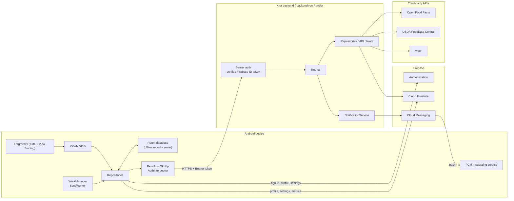
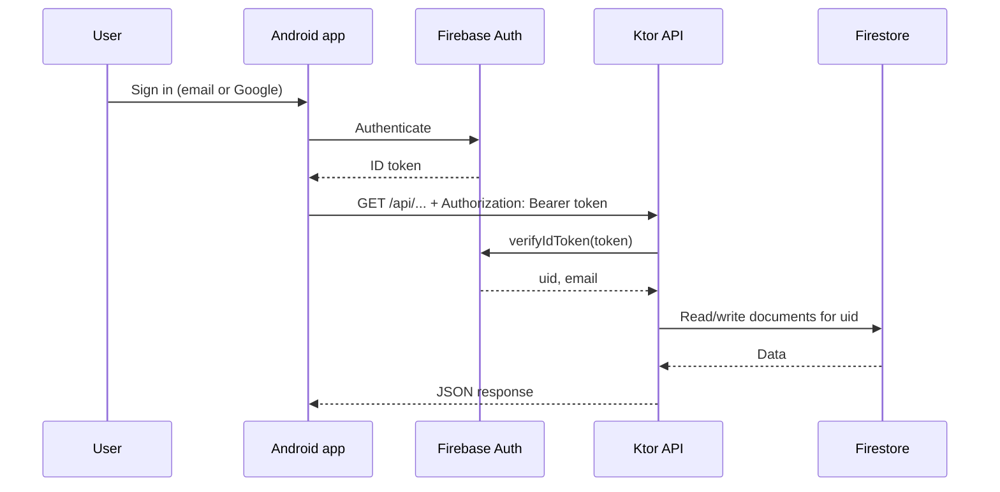
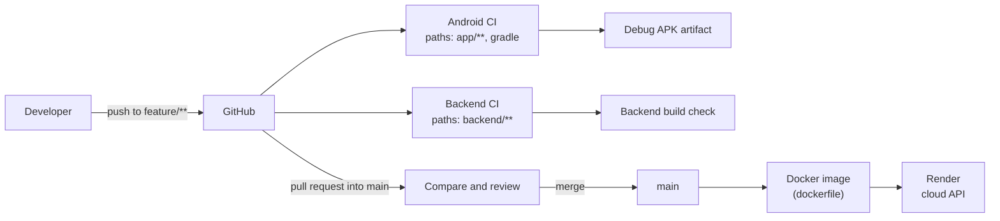

# Kenkosa Health Application

### Technical Report

**An Android app for tracking nutrition, fitness, sleep, fasting, medication and mood in one place, backed by a Kotlin/Ktor REST API, Firebase and push notifications.**

PROG7314 · BCAD3 Group 2

</div>

| | |
|---|---|
| **Module** | PROG7314 |
| **Group** | BCAD3 Group 2 |
| **Team** | Qaniah Arnold (ST10448055), Jade Heeger (ST10445517), Brandon Less (ST10441540) |
| **Repository** | [github.com/st10448055/KenkosaHealthApp-repository-prog7314](https://github.com/st10448055/KenkosaHealthApp-repository-prog7314) |
| **YouTube Link** | https://youtu.be/_KEn0Jy-pnU |
| **Platform** | Android (`minSdk 33`, `targetSdk 36`) with a Ktor backend hosted on Render |

---

## Abstract

Kenkosa Health is a single Android application that replaces the several separate apps people typically use to manage their health. It combines food, water, fasting, sleep, medication, mood, step and goal tracking with a weekly statistics view, push notifications and an optional biometric lock. The system is a client/server design: a Kotlin Android client built with MVVM and a repository layer, and a Ktor REST API that verifies Firebase identity tokens and stores user data in Cloud Firestore. Mood and water logs work offline and synchronise in the background. This report describes the purpose and scope of the application, its architecture and design decisions, its API, and the DevOps practices used to build, test, version and deploy it.

---

## Table of Contents

1. [Introduction](#1-introduction)
2. [Requirements and Features](#2-requirements-and-features)
3. [Application Showcase](#3-application-showcase)
4. [System Design](#4-system-design)
5. [Technology Stack](#5-technology-stack)
6. [API Reference](#6-api-reference)
7. [DevOps Integration](#7-devops-integration)
8. [Security Considerations](#8-security-considerations)
9. [Getting Started](#9-getting-started)
10. [Testing and Quality Assurance](#10-testing-and-quality-assurance)
11. [Limitations and Future Work](#11-limitations-and-future-work)
12. [Acknowledgements](#12-acknowledgements)

---

## 1. Introduction

### 1.1 Purpose

Most people who want to look after their health end up juggling several apps: one for food, one for workouts, one for sleep, another for medication reminders. **Kenkosa Health** brings these together into a single mobile app so a user can see their day at a glance, log entries quickly, and track progress against personal goals.

### 1.2 Objectives

- Provide secure account creation and sign-in (email/password and Google single sign-on), with an optional biometric lock
- Offer one home dashboard that links to every health module
- Make logging fast: barcode scanning and food search for meals, one-tap water logging, and automatic step counting
- Keep working without a connection for the most frequent actions (mood and water) and sync later
- Keep every user's data behind authenticated API calls
- Support South African users with English, Afrikaans and isiXhosa

### 1.3 Scope

The project delivers an Android client (`:app`) and a REST API (`:backend`) in one repository, plus the CI/CD workflows and container image needed to build and deploy them. iOS, a web client and wearable integration are out of scope (see [Section 11](#11-limitations-and-future-work)).

---

## 2. Requirements and Features

### 2.1 Functional requirements

| Module | What it does |
|---|---|
| **Authentication** | Email/password sign-up and login, Google SSO (Android Credential Manager), and sign-out via Firebase Authentication |
| **Biometric lock** | Optional fingerprint/face unlock. The app locks on a cold start and again after 30 seconds in the background. It can only be enabled when the device has enrolled biometrics, and it switches itself off if biometrics become unavailable |
| **Home dashboard** | Entry point to every module, a calorie ring driven by the daily target, an add menu, and navigation to Settings and Statistics |
| **Food diary** | Log meals by type, scan a barcode with the camera, search foods by name, add notes, and browse meal history |
| **Water intake** | Log water through the day and see progress. Works offline |
| **Steps** | Counts today's steps with the phone's hardware step counter. The count fills any *steps* goal automatically |
| **Fasting** | Record fasts and view progress on a ring display, with a history of past fasts |
| **Sleep** | Log sleep and view a ring and weekly bar chart against a sleep target |
| **Medication** | Add medications with schedules and mark doses as taken |
| **Wellness** | Log your mood (works offline) and browse guided meditation videos |
| **Goals** | Create daily, weekly or monthly goals (steps, water, sleep, exercise or custom) and update progress |
| **Statistics** | Seven-day view of water, calories and sleep |
| **Fitness** | Browse workout categories and exercises from the wger exercise database |
| **Know Your Health** | Read health and lifestyle articles |
| **Metrics** | Record and update body metrics. The daily calorie target is estimated with the Mifflin-St Jeor equation and an activity multiplier |
| **Notifications** | Push alerts when a water or other goal is reached, plus broadcast announcements in the user's language. Can be switched off in Settings |
| **Settings** | Appearance (light/dark), language, units (metric/imperial), haptic feedback, notification and biometric toggles, profile, and personal targets (daily steps, calories, sleep) |

### 2.2 Non-functional requirements

| Quality | How it is addressed |
|---|---|
| **Security** | Firebase ID tokens verified on the server, data scoped to the user's `uid`, optional biometric lock (see [Section 8](#8-security-considerations)) |
| **Availability offline** | Room database plus WorkManager sync for mood and water logs |
| **Maintainability** | MVVM with a repository layer on the client; one routes/models/repository file per feature on the server |
| **Localisation** | English, Afrikaans and isiXhosa string resources, and localised push text |
| **Portability** | Backend packaged as a Docker image; Android build configured through Gradle with a version catalogue |
| **Testability** | Pure-Kotlin logic (lock policy, sleep maths, unit conversion, validation) kept free of Android classes so it runs as plain JVM unit tests |

---

## 3. Application Showcase

| Login | Home | Food diary |
|:---:|:---:|:---:|
|  |  |  |

*Figure 1: Sign-in, the home dashboard and the food diary.*

| Barcode scanner | Sleep | Fasting |
|:---:|:---:|:---:|
|  |  |  |

*Figure 2: Camera barcode scanning, the sleep ring and weekly chart, and the fasting ring.*

| Goals | Wellness | Settings |
|:---:|:---:|:---:|
|  |  |  |

*Figure 3: Goal tracking, mood and meditation, and the settings screen.*

---

## 4. System Design

### 4.1 System overview

Kenkosa Health is a **client/server system** made of two Gradle modules in one repository: an Android client (`:app`) and a Ktor REST API (`:backend`). Firebase provides identity, storage and push messaging for both. The backend is packaged as a Docker image and hosted on Render.



*Figure 4: System architecture.*

### 4.2 Android app: MVVM with a repository layer

| Layer | Responsibility | Package |
|---|---|---|
| **UI** | Fragments, adapters and custom views (rings, bar charts). Only renders state and forwards user actions | `ui/<feature>/` |
| **ViewModel** | Holds screen state, survives configuration changes, exposes results to the UI | `ui/<feature>/*ViewModel.kt` |
| **Repository** | Single source of truth per feature; hides whether data comes from the API, Room or Firebase; wraps results in an `ApiResult` type for consistent error handling | `data/repository/` |
| **Local storage / sync** | Room database for offline mood and water entries, plus a WorkManager job that uploads pending changes | `data/local/`, `data/sync/` |
| **Network / models** | Retrofit interfaces, DTOs, and one shared `RetrofitInstance` | `data/network/`, `data/model/` |
| **Notifications** | FCM service, notification channels, token registration and the in-app notification preference | `notifications/` |
| **Security** | Biometric prompt helper, lock-timing policy and preference | `security/` |

### 4.3 Offline-first synchronisation

Mood and water entries are written to the local Room database first and flagged as *pending*. `SyncWorker` (scheduled through `SyncScheduler`) uploads pending entries and refreshes from the server whenever a network connection is available: once shortly after changes, and roughly every 15 minutes in the background. Temporary failures (no connection, 5xx, expired token, rate limiting) are retried with exponential backoff, and permanent 4xx errors are not retried. The same job also registers the device's push token if that could not be done earlier while offline.

### 4.4 Backend: Ktor with a plugin-per-concern layout

The API is a small Ktor server on Netty. Cross-cutting concerns are installed as plugins in `Application.module()` in a fixed order: **Firebase → Serialization → Authentication → StatusPages → Routing**. Each health feature has its own `routes/`, `models/` and `repository/` file, so a feature can be added or changed without touching the others. A separate `notifications/` package builds and sends FCM messages.

### 4.5 Authentication flow

The client never sends passwords to our API. It signs in with Firebase, then attaches the Firebase ID token to every API request. The server verifies the token with the Firebase Admin SDK and scopes all data to the token's `uid`.



*Figure 5: Authentication and request flow.*

On top of Firebase sign-in, users can turn on a **biometric lock** in Settings. The decision of *when* to lock lives in `BiometricLockPolicy`, a pure Kotlin object with no Android dependencies so it can be unit tested on the JVM.

### 4.6 Push notifications

Notifications are sent as FCM **data messages**: the server decides the text (in the user's chosen language) and the destination screen, and the app builds the notification itself. This lets the app respect the in-app notification switch and open the right screen on tap.

- **Per-user alerts:** `NotificationService` looks up the user's device tokens and language and sends a message when a water goal is reached or a goal is completed. Sending is fire-and-forget, so a failed push never affects the user's data. Dead tokens are removed automatically.
- **Announcements:** phones subscribe to `announcements_en`, `announcements_af` and `announcements_xh` topics. `POST /api/admin/announcements` (protected by the `ADMIN_API_KEY` environment variable) broadcasts to them.
- **Channels:** two Android notification channels, *updates* (default importance) and *alerts* (high importance).

### 4.7 Key design decisions

| Decision | Rationale |
|---|---|
| Firebase ID tokens instead of an own login endpoint | Passwords never reach our API; identity is handled by a managed service |
| Repository layer with an `ApiResult` wrapper | Screens handle success and failure the same way regardless of the data source |
| Room only for mood and water | These are the most frequent, smallest entries, so offline value is highest for the least complexity |
| Pending flag plus WorkManager | Sync survives the app being closed and retries with backoff |
| Data messages for push | The app controls display, honours the in-app switch, and can deep-link to a screen |
| One routes/models/repository file per backend feature | Features can be added or changed in isolation |
| Pure-Kotlin helpers for lock policy, sleep maths and unit conversion | Easy to unit test without an emulator |
| Build-time API URL (`BuildConfig`) | Release builds can never point at a local HTTP server |

### 4.8 Project structure

```
kenkosaHealthApp_PROG7314/
├── app/                                  # Android client
│   └── src/
│       ├── main/
│       │   ├── java/.../kenkosahealthapp_prog7314/
│       │   │   ├── MainActivity.kt, KenkosaApp.kt
│       │   │   ├── data/
│       │   │   │   ├── local/            # Room database, DAOs, entities
│       │   │   │   ├── model/            # User, UserSettings, UserMetrics, CalorieCalculator
│       │   │   │   ├── network/          # Retrofit APIs, DTOs, AuthInterceptor, ApiConfig
│       │   │   │   ├── repository/       # One repository per feature
│       │   │   │   └── sync/             # SyncWorker, SyncScheduler, NetworkMonitor
│       │   │   ├── notifications/        # FCM service, channels, token manager
│       │   │   ├── security/             # Biometric helper and lock policy
│       │   │   └── ui/                   # auth, home, diary, fasting, fitness, goals,
│       │   │                             # knowhealth, medication, metrics, settings,
│       │   │                             # sleeplog, stats, steps, water, wellness
│       │   └── res/                      # layouts, nav_graph, values, values-af, values-xh
│       └── test/                         # JVM unit tests
├── backend/                              # Ktor REST API
│   └── src/
│       ├── main/
│       │   ├── java/com/kenkosa/backend/
│       │   │   ├── Application.kt
│       │   │   ├── plugins/              # Firebase, Authentication, Routing, ...
│       │   │   ├── routes/               # One file per feature
│       │   │   ├── models/               # Request/response models and validation
│       │   │   ├── notifications/        # FCM sending and message text
│       │   │   └── repository/           # Firestore + third-party API clients
│       │   └── resources/application.conf
│       └── test/                         # Validation and notification text tests
├── .github/workflows/                    # android-ci.yml, backend-ci.yml
├── dockerfile                            # Backend container image
├── gradle/libs.versions.toml
└── settings.gradle.kts
```

---

## 5. Technology Stack

| Area | Technology |
|---|---|
| Language | Kotlin |
| Android UI | XML layouts, View Binding, Material Components, Navigation Component, RecyclerView |
| Android architecture | MVVM, ViewModel, Kotlin coroutines |
| Networking | Retrofit, OkHttp, Gson, Coil (images) |
| Offline and background | Room (with KSP), WorkManager |
| Camera and scanning | CameraX, ML Kit Barcode Scanning |
| Identity and data | Firebase Authentication, Android Credential Manager (Google sign-in), Cloud Firestore |
| Security | AndroidX Biometric |
| Push notifications | Firebase Cloud Messaging |
| Backend | Ktor 2.3 (Netty), kotlinx.serialization, Firebase Admin SDK, Shadow (fat JAR) |
| External data | Open Food Facts, USDA FoodData Central, wger |
| Deployment | Docker (Eclipse Temurin 21), hosted on Render |
| Build | Gradle 9 (Kotlin DSL) with a version catalogue |
| Target | Android `minSdk 33` (Android 13), `targetSdk 36` |

---

## 6. API Reference

All `/api/**` endpoints require a Firebase ID token in the `Authorization: Bearer <token>` header, and all data is scoped to the token's `uid`. The only public endpoint is `GET /health`.

| Resource | Base path | Notes |
|---|---|---|
| Health check | `/health` | Public. Used by Render's health check |
| Meal diary | `/api/diary` | Log, update (`PATCH`) and delete meals |
| Food search | `/api/food/search`, `/api/food/results` | Open Food Facts (barcode) and USDA FoodData Central (name search) |
| Water | `/api/water` | Daily cups. Sends a push when the goal is reached |
| Fasting | `/api/fasts` | CRUD |
| Sleep | `/api/sleep-log` | CRUD |
| Medication | `/api/medications` | CRUD, plus `PUT /{id}/taken` to mark a dose |
| Mood | `/api/moods` | CRUD |
| Goals | `/api/goal-tracking` | CRUD, plus `PUT /{id}/progress`. Sends a push when a goal completes |
| Notes | `/api/notes` | Diary notes |
| Workouts | `/api/workouts` | Categories and exercises proxied from wger (`/categories`, ...) |
| Statistics | `/api/stats/weekly`, `/api/stats/sync-goals` | Last 7 days of water, calories and sleep (accepts `tz` and `endDate`); goal syncing |
| Devices | `/api/devices/token` | Register or remove the phone's FCM token |
| Notifications | `/api/notifications/test` | Send yourself a test push |
| Announcements | `/api/admin/announcements` | Admin broadcast in `en`, `af` and `xh`. Needs the `X-Admin-Key` header |

---

## 7. DevOps Integration

### 7.1 Pipeline overview



*Figure 6: Version control, CI and deployment flow.*

### 7.2 Version control

The project is managed in Git and hosted on GitHub. Three team members contributed, and all work was done on branches rather than directly on `main`. `main` is the default, protected branch and is always mergeable.

#### Branching strategy

Work is done on short, purpose-named branches: a `feature/<name>` branch for each feature area. Branches were created from the latest completed branch, so each new feature builds on the work before it and the feature branches form a stack that leads back into `main`.



*Figure 7: Stacked feature-branch history.*

```mermaid
flowchart LR
    main["main"] --> part2["part2<br/>auth, navigation, settings"]
    part2 --> dev["feature/dev<br/>home, side nav, goals, sleep"]
    dev --> settings["updated-settings<br/>languages, food search UI"]
    settings --> med["feature/medication"]
    med --> well["feature/wellness"]
    well --> food["feature/food-search<br/>barcode scanner"]
    food --> fast["feature/fasting"]
    fast --> work["feature/workouts"]
    work --> water["feature/water-intake"]
    water --> metrics["feature/user-metrics"]
    metrics --> diary["feature/diary"]
```

| Branch | Focus |
|---|---|
| `main` | Default, stable branch |
| `part2` | Firebase authentication, navigation and settings foundation |
| `feature/dev` | Home screen, side navigation, goals and sleep tracking |
| `updated-settings` | Redesigned settings, Afrikaans and isiXhosa, food search UI |
| `feature/medication` | Medication tracking and food log history |
| `feature/wellness` | Mood and meditation features |
| `feature/food-search` | Food search backend and barcode scanner |
| `feature/fasting` | Fasting tracker and "Know Your Health" articles |
| `feature/workouts` | wger workout integration |
| `feature/water-intake` | Water tracking |
| `feature/user-metrics` | Body metrics |
| `feature/diary` | Diary for meals, water and mood |


*Figure 8: Branch and commit history on GitHub.*

#### Working practices

- **Naming convention.** Feature work uses the `feature/**` pattern (for example `feature/diary`), which keeps work in progress separate from `main` until it is reviewed and ready to merge.
- **Pull request comparison and review.** Before merging, changes are compared against `main` using GitHub's Compare & Pull Request view, which shows the commit history, the files changed, and whether the branches merge cleanly or have conflicts.
- **Small, descriptive commits.** Each commit describes one piece of work (for example *"Implemented Food Barcode Scanner"* or *"Fixed Food Log History Display Bug"*), so the history reads as a project log.
- **Isolated feature work.** Unfinished work never breaks the stable baseline and features can be reviewed on their own.
- **Shared ownership.** All three contributors committed regularly, visible in the repository's commit history and contributor graph.

### 7.3 Continuous integration with GitHub Actions

Two separate workflows verify the two halves of the project. Each is scoped to its relevant files so unrelated changes do not trigger unnecessary builds, and both can be started manually from the Actions tab (`workflow_dispatch`).

#### Android CI (`android-ci.yml`)

Triggered on pushes to `main` and `feature/**` branches, and on pull requests into `main`. Pushes run only when files under `app/**`, Gradle configuration files, or the workflow file itself change. Pull requests run when files under `app/**` change.

1. Check out the repository
2. Set up JDK 17
3. Cache Gradle dependencies
4. Grant execute permission to the Gradle wrapper
5. Base64-decode the `GOOGLE_SERVICES_JSON` secret into `app/google-services.json`
6. Build the debug APK with `:app:assembleDebug`
7. Upload the APK as a downloadable build artifact

#### Backend CI (`backend-ci.yml`)

Uses the same triggers, scoped to changes under `backend/**`.

1. Check out the repository
2. Set up JDK 17
3. Cache Gradle dependencies
4. Grant execute permission to the Gradle wrapper
5. Base64-decode the `FIREBASE_SERVICE_ACCOUNT_KEY` secret into `backend/serviceAccountKey.json`
6. Run `:backend:build` with tests and the shadow distribution packaging tasks skipped (`-x test -x shadowDistTar -x shadowDistZip -x startShadowScripts`)

This gives fast feedback on whether each half still compiles. Unit tests are not part of either workflow yet, so run them locally before opening a pull request (see [Section 10](#10-testing-and-quality-assurance)).

### 7.4 Secrets management

Both workflows keep sensitive credentials out of the repository. The Firebase service account key and `google-services.json` are stored as encrypted GitHub Actions secrets and are injected only when needed during the build. Locally, `.gitignore` excludes `local.properties` and `serviceAccountKey.json`, and `.dockerignore` keeps the service account key out of the container image.

### 7.5 Containerisation and deployment

The backend ships as a Docker image built from the `dockerfile` in the repository root:

1. **Build stage** (Eclipse Temurin 21 JDK): normalises the Gradle wrapper's line endings, removes the `:app` module from `settings.gradle.kts` (the image has no Android SDK) and runs `:backend:shadowJar`.
2. **Runtime stage** (Eclipse Temurin 21 JRE): copies the fat JAR and starts it, listening on `PORT` (default `8080`).

On Render, set `FIREBASE_SERVICE_ACCOUNT_PATH` (pointing at the mounted service account file), `USDA_API_KEY` and `ADMIN_API_KEY` as environment variables or secret files. `GET /health` is used for health checks and to wake the free instance.

---

## 8. Security Considerations

| Area | Measure |
|---|---|
| **Identity** | Firebase Authentication; the client never sends passwords to the API |
| **API access** | Every `/api/**` route requires a Bearer token verified server-side with the Firebase Admin SDK; data is read and written only under the token's `uid` |
| **Transport** | Release builds always use the HTTPS cloud URL; a local HTTP override is possible only in debug builds through `local.properties` |
| **Logging** | OkHttp logging is set to `BASIC` so bearer tokens never reach Logcat |
| **Admin endpoint** | Disabled unless `ADMIN_API_KEY` is set; the supplied key is compared in constant time |
| **Device protection** | Optional biometric lock with a 30-second re-lock timeout |
| **Input validation** | Request models validate their input (for example, FCM token format, announcement length and language codes) before touching Firestore |
| **Backups** | Shared preferences are excluded from Android cloud backup and device transfer |
| **Secrets** | Kept in GitHub Actions secrets or git-ignored files, never committed to the codebase |

---

## 9. Getting Started

### 9.1 Prerequisites

- Android Studio (recent stable release) with an Android emulator or device running **API 33 or higher**
- A JDK supported by Gradle 9.x (Android Studio's bundled JDK works)
- A Firebase project with **Authentication** (Email/Password and Google), **Cloud Firestore** and **Cloud Messaging** enabled
- A free [USDA FoodData Central API key](https://fdc.nal.usda.gov/api-key-signup.html) (for food search)

### 9.2 Clone the repository

```bash
git clone https://github.com/st10448055/KenkosaHealthApp-repository-prog7314.git
cd KenkosaHealthApp-repository-prog7314
```

### 9.3 Configure Firebase

**Android app:** download `google-services.json` from your Firebase project settings and place it at `app/google-services.json`.

**Backend:** in the Firebase console go to *Project settings → Service accounts → Generate new private key*, and save the file as `backend/serviceAccountKey.json`.

> **Never commit `serviceAccountKey.json`.** It is listed in `.gitignore`. If you need to point to a different location, set `FIREBASE_SERVICE_ACCOUNT_PATH`.

### 9.4 Choose which API the app talks to

By default (and for every release build) the app uses the **cloud-hosted API on Render**, so you can run the app without starting a backend at all. The URL is set at build time in `app/build.gradle.kts` and exposed to code through `ApiConfig.BASE_URL`.

> The free Render instance sleeps when idle, so the first request after a quiet period can be slow.

To develop against a backend on your own machine, add this line to `local.properties` (git-ignored, so it never affects teammates):

```properties
api.baseUrl=http://10.0.2.2:8080/
```

`10.0.2.2` is the Android emulator's alias for the host machine's `localhost`. On a physical device, use your computer's LAN address instead. Release builds ignore this override.

### 9.5 Run the backend locally (optional)

| Variable | Purpose | Default |
|---|---|---|
| `USDA_API_KEY` | USDA FoodData Central key used for food search | none (food search will not return results) |
| `FIREBASE_SERVICE_ACCOUNT_PATH` | Path to the service account JSON | `serviceAccountKey.json` |
| `ADMIN_API_KEY` | Secret for `POST /api/admin/announcements`, sent in the `X-Admin-Key` header | none (the announcement endpoint stays unavailable) |
| `PORT` | Port the server listens on | `8080` |

```bash
# macOS / Linux
export USDA_API_KEY=your_key_here
./gradlew :backend:run

# Windows (PowerShell)
$env:USDA_API_KEY="your_key_here"
.\gradlew.bat :backend:run
```

The API is now available at `http://localhost:8080`.

### 9.6 Run the app

1. Open the project in Android Studio and let Gradle sync.
2. Select the `app` run configuration and an emulator or device.
3. Press **Run**.

Grant the notification, camera and activity-recognition permissions when prompted to use push notifications, the barcode scanner and the step counter. The step counter needs a device or emulator image with a step-counter sensor.

To build a debug APK from the command line:

```bash
./gradlew :app:assembleDebug
```

---

## 10. Testing and Quality Assurance

```bash
./gradlew :app:testDebugUnitTest   # Android unit tests
./gradlew :backend:test            # backend tests
```

| Module | Test coverage |
|---|---|
| **Android** | Biometric lock timing (`BiometricLockPolicyTest`), sleep calculations (`SleepMathTest`), unit conversion (`UnitFormatterTest`), notification screen mapping (`NotificationScreenTest`) |
| **Backend** | Request validation for goals, diary, water, sleep and notifications, plus notification text |

Quality is also supported by the CI builds on every push and pull request, the pull request review step before merging, and keeping business logic in pure Kotlin so it can be tested without an emulator.

---

## 11. Limitations and Future Work

- **Tests are not yet run in CI.** Both workflows build only; adding `testDebugUnitTest` and `:backend:test` steps would catch regressions earlier.
- **Offline support is partial.** Only mood and water logs use Room. Extending it to meals, sleep, fasting and medication would make the whole app usable offline.
- **Local database migrations.** The Room database currently falls back to destructive migration, so a schema change would clear local data. Proper migrations should be added before wider release.
- **Hosting.** The free Render tier sleeps when idle, causing a slow first request. A paid or always-on plan would remove this.
- **Platforms.** Android only. Wearable and health-platform integration (for example automatic step or heart-rate import) is not yet implemented.

---

## 12. References

- [Firebase](https://firebase.google.com/) for authentication, Cloud Firestore and Cloud Messaging
- [Open Food Facts](https://world.openfoodfacts.org/) for barcode product data
- [USDA FoodData Central](https://fdc.nal.usda.gov/) for food nutrition data
- [wger](https://wger.de/) for the exercise and workout database
- Google ML Kit and CameraX for barcode scanning
- [Render](https://render.com/) for backend hosting
